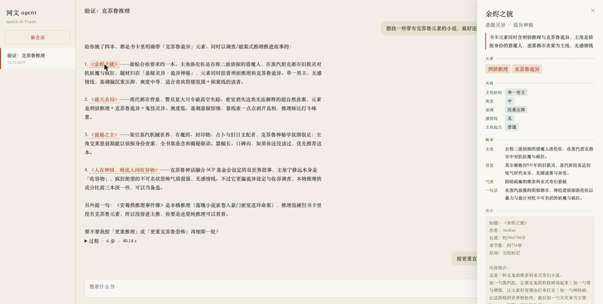

# inovel-agent: a conversational agent over a Chinese web-novel corpus, and how to evaluate it

> English summary. The Chinese [`README.md`](README.md) is the primary one, and all
> other documents are in Chinese.

A conversational agent over a private library of Chinese web novels: the user says in plain
language what they want to read, the agent searches, verifies, reads the books' records and
recommends with its reasons, and can answer plot questions about one book. Corpus: 7,655
novels, about 36 GB of plain text with no tags or metadata, private, not in git. Offline
extraction and retrieval are the technical core: every structured signal (digest, book card,
vectors) is extracted from the text offline, and the agent only consumes those artefacts.

## Demo

Demo video (2:48, silent): [`demo/demo.mp4`](demo/demo.mp4)

https://github.com/i4cobus/inovel-agent/raw/master/demo/demo.mp4



## Data flow

```
raw text ──02──▶ digest (~40k chars per book: synopsis + 4 whole opening chapters + 100 chapter titles
                 + 6 whole middle chapters + 2 whole ending chapters)
                  ├──32──▶ book card (an LLM fills a closed three-layer vocabulary per book)
                  └──30──▶ multi-vector index (digest cut into ≤1,500-char paragraph chunks + the card, Qwen3-Embedding-4B)
                             └──33──▶ pooled single-vector index (the agent's default)

agent (Qwen3.8-Flash; local Qwen3.5-9B as the comparison arm)
  ├─ tools: search_books / similar_books / get_profile / ask_book / check_term / check_trope / set_aside / memory_read / memory_write / finish
  └─ sessions: each with its own memory, numbered recommendations and transcript ──▶ web UI (scripts/serve.py)
```

**Digest** (`src/digest.py`): a deterministic sample that stands in for a book of several
hundred thousand to several million characters. Its version is part of the card cache key
and of the index metadata, so stale pairs cannot be mixed.

**Book cards** (`src/retrieval/cards.py`, `card_schema.py`): one structured record per
book, produced by an LLM from the whole digest. Three layers with a closed vocabulary:
genre (12 top-level, 41 sub-genres; the model fills only the sub-genre), elements (40, in
four groups; every element must carry a ≤20-char verbatim quote that the parser checks
against the digest), and five style scales (protagonist structure, 爽度, tone, romance
line, starting point). The vocabulary was audited line by line against the Qidian/Zongheng
taxonomies rather than copied; anything outside it is dropped and the reason recorded.
7,410 of 7,655 books have a card; 245 were rejected by the endpoint's content filter and are
left without one. Cards feed the index as one section, the hard filters of `search_books`,
`get_profile` (card first, then synopsis and opening) and `check_trope` (the card answers
what its genre, elements and style scales can; the text is sampled only when the card is silent).

**Index** (`src/retrieval/multivector.py`, `pooling.py`, `hybrid.py`, `catalog.py`): one
vector per chunk, a book scores as its best chunk (294,485 vectors in all; the card sections
can be embedded and appended after the main build with identical results on a flat
inner-product index). The single-vector index averages a book's chunks per section kind and
then weights the kinds, which takes seconds on CPU per weighting; `search_books` uses it.
Card filters are exact FAISS id selection, not post-filtering. BM25 over jieba tokens and
reciprocal-rank fusion are kept as reference configurations. Embeddings: Qwen3-Embedding-4B
in bf16 (batch 8, 1,536-token cap on a 16 GB card; about 8 hours for the full build).

**Agent** (`src/agent/`): an OpenAI-compatible tool-calling loop with nine tools plus
`finish`. Users talk in natural language; the agent writes the retrieval query itself and it
reaches the embedder verbatim. Finding books: `search_books` with hard filters from the
book cards when the user names a genre, element or style, and `exclude_shown` for "show me
others"; `similar_books` searches with a book's own vector. Checking: negatives never reach
the retriever; `check_term` (full-text term densities) and `check_trope` (card first, sampled
text when the card is silent; 27 tags) verify candidates, and only the conditions the user
stated or memory holds are checked; `get_profile` answers positive preferences. In-book
questions: `ask_book` retrieves passages within one book over its digest chapters, reusing
the multi-vector index's chunk vectors through a memory map, and answers cite chapter
headings. Conversation: session state records what was recommended (numbered) and set aside
so "the second one" and "something else" resolve; a request too vague to act on ends with a
question (`asks_user`); every turn ends with `finish` (answer, recommendations, citations).
Memory: long-term entries ("never 后宫 again") persist and are rendered into the system
prompt every turn; one-off ones are not persisted. Context: tool results have a character
budget, older search results are compacted to id|title, and only the last 8 turns are
replayed across turns. Bounds: at most 10 steps per turn, two consecutive tool-less steps
end it, a repeated identical call ends it, the transport retries an endpoint error 3 times
and then the turn ends.

**Sessions and UI** (`src/agent/sessions.py`, `web.py`, `static/index.html`,
`scripts/serve.py`): a session is one independent context: switch to another kind of book,
or another person, by opening a new one. Each session is a fork of the agent over the
shared backends (encoder, index, profiles, densities, judge), with its own memory file,
session state and transcript under `data/sessions/<id>/`, restored after a restart.
Starlette serves the API and one page: sessions on the left, the conversation with each
tool call and its one-line result streamed as it completes (server-sent events) in the
middle, memory and the numbered recommendations on the right; clicking a title in the answer
opens the book's card. Nothing calls a model while nobody is talking.

## Evaluation

Two stages are evaluated separately so that failures can be attributed: did the index supply
the candidates, or did the agent not follow the procedure?

- **Agent stage** (`src/agent_eval/`, `eval/agent/tasks/`, `docs/agent-dev-rounds.md`):
  two task kinds checked by program. Constrained recommendation (genre + positive features
  + 1–2 negatives: number of recommendations, were they among the search results, was every
  negative checked per book, does any rule-checkable negative fail) and cross-turn memory
  (persist / accumulate / one-off variants: the memory file and the later recommendations).
  Tasks are synthesised from templates and vocabularies and split with a fixed seed into
  test 75 / dev 20. Two dev rounds: Qwen3.8-Flash 0.55 → 0.75, Qwen3.7-Plus 0.30 → 0.70,
  with five fixes in between (truncated finish, preference-only turns not ending, trope-check
  coverage, element given as genre, the scoring rule for memory tasks); Flash is the main
  model. The test split has not been run yet.
- **Index stage** (`src/retrieval/supply.py`, `supply_judge.py`, `docs/retrieval-supply.md`):
  candidate supply as the agent uses it, with the queries the agent actually emitted in its
  trajectories; metrics are top-k positive precision, feasibility (do at least three
  candidates survive the negatives), anchor hits, card consistency and paraphrase robustness;
  relevance from pooled LLM judging calibrated on human-labelled pairs. The code exists; it
  has not been run on the 4B index yet.
- The current task sets cover whether the procedure is followed, not whether the
  recommendations are good, nor realistic user requests; a full evaluation (realistic request
  set, in-book QA, follow-ups and clarification, a recommendation-quality judge) is the next
  stage.

## Repository layout

| path | contents |
|---|---|
| `src/digest.py` | digest rules and version |
| `src/retrieval/` | cards and vocabulary, filter catalog, multi-vector index and chunking, pooling, BM25, hybrid, candidate-supply evaluation |
| `src/agent/` | loop, tools, memory, session state, passage retrieval, context budget, trajectories; session store, web API and page |
| `src/agent_eval/` | task synthesis, concurrent runner, hard metrics |
| rest of `src/` | corpus cleaning and chapter splitting, embedding and FAISS, the constraint rule (`preferences.py`), evidence sampling, judge and calibration, transport |
| `scripts/` | 01–02 corpus and digest; 30/30b indexes and card-section append, 31 benchmark, 32 cards, 33 pooling, 34–36 task synthesis / agent eval / metrics, 37 card review page, 40–43 candidate supply; `chat.py` terminal chat, `serve.py` web server; 10–16 are v1 leftovers |
| `eval/` | task sets and run records (`eval/agent/runs/`, redacted trajectories), the v1 queries and human labels |
| `docs/agent-plan.md` | design document |
| `docs/agent-rework.md`, `docs/agent-dev-rounds.md` | the agent-layer rework; the two dev rounds, fixes and model choice |
| `docs/card-schema-v3.md`, `docs/book-cards-pilot.md` | card vocabulary and prompt, pilot history |
| `docs/retrieval-supply.md`, `docs/retrieval-bench.md` | candidate-supply evaluation design; the v1 benchmark (history) |
| `docs/v1-reranker/` | the predecessor: reranker post-training (SFT + GRPO) |

```bash
uv sync
uv run pytest      # 250 tests, CPU only, no model downloads
uv run python scripts/serve.py --base-url <endpoint> --api-key-file <key> --no-thinking --port 8765   # web UI, bound to 127.0.0.1
uv run python scripts/chat.py --base-url <endpoint> --api-key-file <key> --no-thinking                # terminal chat
```

Model calls read `INOVELREC_LLM_API_KEY` or `--api-key-file` and the endpoint from
`INOVELREC_LLM_BASE_URL`; no credentials live in the repository. Development happens on a
Mac; card building, index building and agent runs are scheduled tasks on a Windows machine
with an RTX 4080, where the UI also runs, reached through an ssh tunnel.

## Data and copyright

The corpus is private full text and never enters git or any committed artefact: trajectories
in the run records are redacted (passages replaced by fingerprints), and cards hold only
vocabulary labels and ≤20-char verification quotes. The UI shows titles, card fields, the
author's synopsis and the agent's own words; the opening excerpts of `get_profile` and the
passages of `ask_book` go to the model only and are not displayed in the page's trace.

## Status (2026-10-12)

Done: digest v2, book cards v3.2 (7,410), the 4B multi-vector and pooled single-vector
indexes, the agent layer reworked for natural-language conversation, two dev rounds and the
model choice, the multi-session web UI running against the real index.
In progress: the agent-side test run with the 9B comparison; the first candidate-supply
evaluation on the 4B index.
Next: a realistic request set and new task types (in-book QA, follow-ups, clarification), a
recommendation-quality judge; a build-on-demand full-book passage index.
