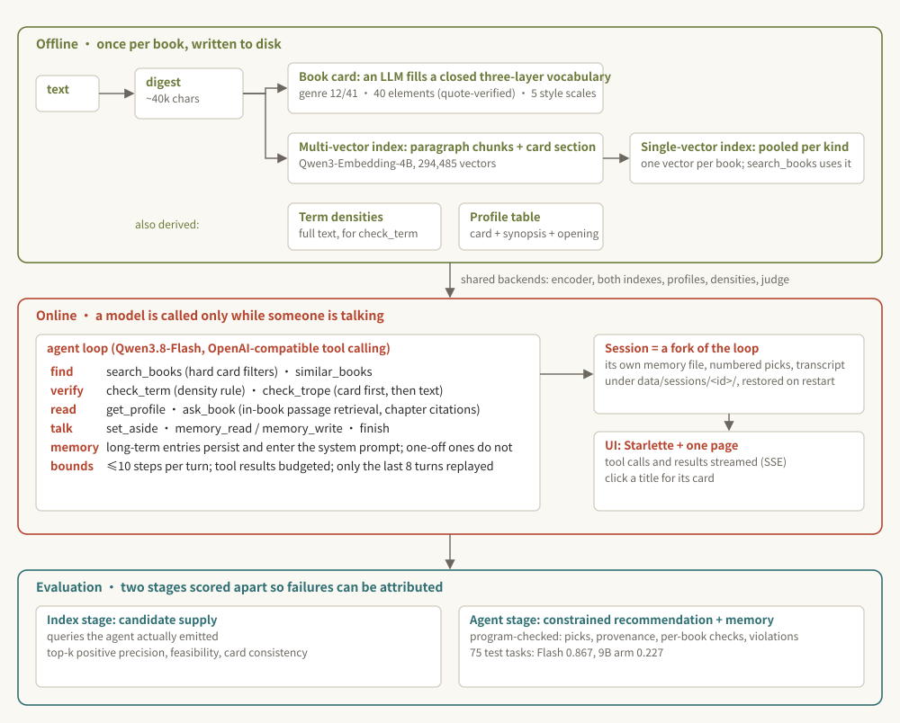

# inovel-agent: a conversational agent over a Chinese web-novel corpus

> English summary. The Chinese [`README.md`](README.md) is the primary one, and all
> other documents are in Chinese.

A conversational agent over a library of 7,655 Chinese web novels: the user says in plain
language what they want to read, the agent searches, verifies, reads the books' records and
recommends with its reasons, and can answer plot questions about one book. The corpus is
plain text with no tags or metadata, so the technical weight is in offline extraction: the
digest, the book card and the vectors are all derived from the text, and the agent only
consumes those artefacts.

## Demo


Full video: [`demo/demo.mp4`](demo/demo.mp4) · screenshot: [`demo/ui.jpg`](demo/ui.jpg)

## Architecture



### Offline

**Digest** (`src/digest.py`): a deterministic sample that stands in for a book of several
hundred thousand to several million characters (synopsis, four opening chapters, 100 evenly
sampled chapter titles, six evenly placed whole chapters, two closing chapters; 8,000 chars
per chapter at most). Its version is part of the card cache key and of the index metadata.

**Book cards** (`src/retrieval/cards.py`, `card_schema.py`): an LLM reads the whole digest
and fills a closed vocabulary in three layers: genre (12 top-level, 41 sub-genres; the model
fills only the sub-genre), elements (40; every one must carry a ≤20-char verbatim quote that
the parser checks against the digest), and five style scales (protagonist structure, 爽度,
tone, romance line, starting point). The vocabulary was audited line by line against the
Qidian/Zongheng taxonomies; anything outside it is dropped and the reason recorded. 7,410 of
7,655 books have a card. Design history in `docs/card-schema-v3.md`, `docs/book-cards-pilot.md`.

**Index** (`src/retrieval/multivector.py`, `pooling.py`, `hybrid.py`, `catalog.py`): one
vector per ≤1,500-char paragraph chunk with the chapter heading repeated, the card as its own
section, a book scores as its best chunk (294,485 vectors). The single-vector index averages a
book's chunks per section kind and then weights the kinds, seconds on CPU per weighting;
`search_books` uses it. Card filters are exact FAISS id selection, not post-filtering. BM25
and reciprocal-rank fusion are kept as reference configurations. Qwen3-Embedding-4B in bf16,
about 8 hours for the full build on a 16 GB card.

### Online

**Agent** (`src/agent/`): nine tools plus `finish`; the agent writes the retrieval query
itself and it reaches the embedder verbatim.

- Find: `search_books` with hard card filters when the user names a genre, element or style,
  `exclude_shown` for "show me others"; `similar_books` searches with a book's own vector.
- Verify: negatives never reach the retriever. `check_term` uses full-text term densities
  (words that occur in the text, such as 系统); `check_trope` asks the card first and samples
  the text when the card is silent (27 tags such as 后宫, 圣母, 压抑). Only the conditions the
  user stated or memory holds are checked; positive wishes are judged from `get_profile`.
- In-book questions: `ask_book` retrieves passages within one book over its digest chapters,
  reusing the multi-vector index's chunk vectors through a memory map; answers cite chapters,
  and what the digest does not cover is reported as such.
- Conversation: session state records what was recommended (numbered) and set aside, so
  "the second one" and "something else" resolve; a request too vague to act on ends with a
  question; every turn ends with `finish` (answer, recommendations, citations).
- Memory: long-term entries persist and are rendered into the system prompt every turn;
  one-off ones are not persisted.
- Context and bounds: tool results have a character budget, older search results are compacted
  to id|title, only the last 8 turns are replayed; at most 10 steps per turn, and two
  consecutive tool-less steps, a repeated identical call, or three failed endpoint retries end it.

**Sessions and UI** (`src/agent/sessions.py`, `web.py`, `static/index.html`,
`scripts/serve.py`): a session is one independent context; another kind of book, or another
person, means a new session. Each one is a fork of the agent over the shared backends with its
own memory file, session state and transcript under `data/sessions/<id>/`, restored after a
restart. The page: sessions on the left, the conversation with each tool call and its one-line
result streamed as it completes in the middle, memory and the numbered recommendations on the
right; clicking a title opens the book's card. Nothing calls a model while nobody is talking.

### Evaluation

Two stages are evaluated separately so that failures can be attributed: did the index supply
the candidates, or did the agent not follow the procedure?

- **Agent stage** (`src/agent_eval/`, `eval/agent/tasks/`, `docs/agent-dev-rounds.md`):
  constrained recommendation (genre + positive features + 1–2 negatives: number of picks,
  were they among the search results, was every negative checked per book, does a
  rule-checkable negative fail) and cross-turn memory (persist / accumulate / one-off), both
  synthesised from templates and vocabularies and split with a fixed seed. Extended on 2026-10-27 to five
  kinds (session state: 「换几本」/ the second one / I have read the first; clarification) with test 307 /
  dev 85, the original 75 / 20 kept as a subset with unchanged ids (`docs/agent-tasks.md`). The numbers
  below are on the original 75 / 20. Four dev rounds: Qwen3.8-Flash 0.55 → 0.75 → 0.80, Qwen3.7-Plus 0.30 → 0.70, eight fixes in
  between (the last three from the test's attribution: the loop refuses to recommend a book a check
  marked as violating, remembered exclusions are re-checked like stated ones, a memory write still
  ends with finish); Flash is the main model, the local Qwen3.5-9B the comparison arm. On the 75 test
  tasks Flash passes 0.867 (finish 0.98, per-book check coverage 0.96 / 0.95) and the local 9B
  arm 0.227 (finish 0.66; it answers in prose instead of calling finish, confuses the two check
  tools and hardly uses memory); `docs/agent-test.md` attributes every failure.
- **Index stage** (`src/retrieval/supply.py`, `supply_judge.py`, `docs/retrieval-supply.md`):
  candidate supply as the agent uses it, with the queries the agent actually emitted; top-k
  positive precision, feasibility (do three candidates survive the negatives), anchor hits,
  card consistency, paraphrase robustness; relevance from pooled LLM judging calibrated on
  human-labelled pairs. Not yet run on the 4B index.
- **In-book QA** (`eval/agent/tasks/book_qa.jsonl`, `docs/agent-book-qa.md`): questions generated from the
  digest itself (a named chapter, locating a quoted line, the opening, the ending, and a chapter the digest
  does not hold); program checks whether every cited chapter exists, whether a citation lands on the gold
  chapter, how much of the answer is found in the cited text, and whether an unanswerable question is
  declined as such. 60 tasks, test 45 / dev 15; dev 14/15, test 42/45 (the book resolved 45/45, every citation real, every out-of-coverage question declined; the three failures are ask_book not returning the chapter or the line, attributed to the tool).
- The task sets cover whether the procedure is followed and whether citations are real; a realistic
  request set, follow-ups and clarification, and a recommendation-quality judge are next.

## Repository layout

| path | contents |
|---|---|
| `src/digest.py` | digest rules and version |
| `src/retrieval/` | cards and vocabulary, filter catalog, multi-vector index and chunking, pooling, BM25, hybrid, candidate-supply evaluation |
| `src/agent/` | loop, tools, memory, session state, passage retrieval, context budget, trajectories; session store, web API and page |
| `src/agent_eval/` | task synthesis, concurrent runner, hard metrics |
| rest of `src/` | corpus cleaning and chapter splitting, embedding and FAISS, the constraint rule, evidence sampling, judge and calibration, transport |
| `scripts/` | 01–02 corpus and digest; 30/30b indexes and card-section append, 31 benchmark, 32 cards, 33 pooling, 34–36 task synthesis / agent eval / metrics, 37 card review page, 40–43 candidate supply; `chat.py` terminal chat, `serve.py` web server |
| `eval/` | task sets and run records, the v1 queries and human labels |
| `docs/agent-plan.md` | design document |
| `docs/agent-rework.md`, `docs/agent-dev-rounds.md`, `docs/agent-test.md` | the agent-layer rework; the two dev rounds, fixes and model choice; the test result with per-task attribution |
| `docs/card-schema-v3.md`, `docs/book-cards-pilot.md` | card vocabulary and prompt, pilot history |
| `docs/retrieval-supply.md`, `docs/retrieval-bench.md` | candidate-supply evaluation design; the v1 benchmark |
| `docs/v1-reranker/` | the predecessor: reranker post-training (SFT + GRPO) |

```bash
uv sync
uv run pytest      # 250 tests, CPU only, no model downloads
uv run python scripts/serve.py --base-url <endpoint> --api-key-file <key> --no-thinking --port 8765   # web UI
uv run python scripts/chat.py --base-url <endpoint> --api-key-file <key> --no-thinking                # terminal chat
```

Model calls read `INOVELREC_LLM_API_KEY` or `--api-key-file` and the endpoint from
`INOVELREC_LLM_BASE_URL`. Development happens on a Mac; card building, index building, agent
runs and the UI server run on a Windows machine with an RTX 4080.

## Status (2026-10-27)

Done: digest v2, book cards v3.2, the 4B multi-vector and pooled single-vector indexes, the
agent layer reworked for natural-language conversation, two dev rounds and the model choice, the
Flash-versus-9B comparison on the test split, the three fixes the test asked for verified on dev, the
multi-session web UI running against the real index.
In progress: the extended task sets (test 307 / dev 85): dev 0.882 and **test 0.840 [0.80, 0.88]** done (`docs/agent-test.md`, second round; the largest failure is a skipped check in the memory tasks); the two fixes for the skipped checks verified on dev at 0.906 with skipped checks 6 → 0 (`docs/agent-dev-rounds.md`, round 6; the remaining failures are the hard gate blocking labels the model checked on its own; test not rerun); the candidate-supply evaluation has run once (`docs/retrieval-supply.md`: the pool is what the agent saw in the test run, Qwen3.8-Max judged 4,456 pairs; top-10 precision 0.64 strict / 0.94 lenient, recommendation satisfaction 0.88 strict / 0.99 lenient, pass rate 0.83 on tasks with enough candidates against 0.77 without).
Next: a realistic request set and new task types (in-book QA, follow-ups, clarification), a
recommendation-quality judge; a build-on-demand full-book passage index.
