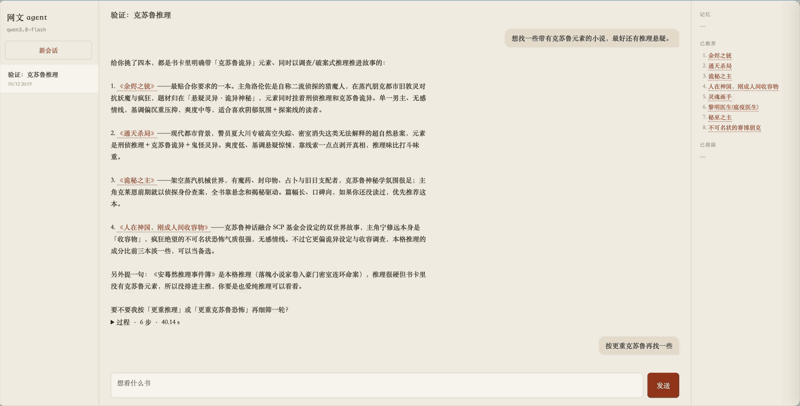
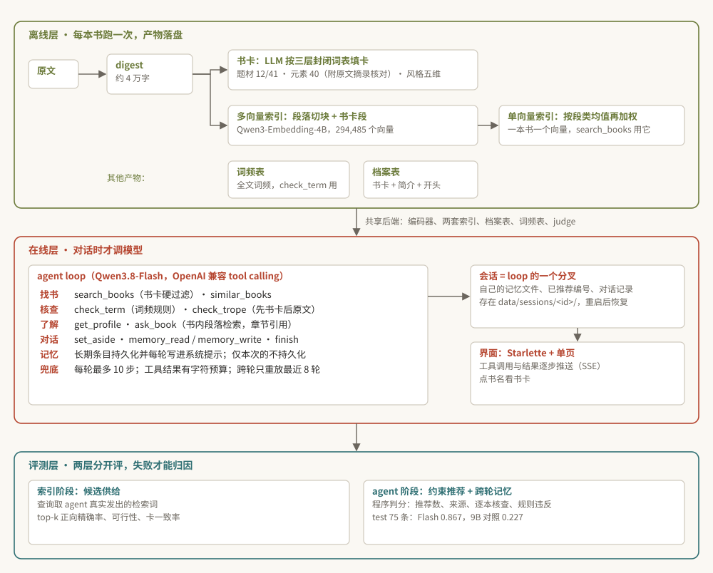

# inovel-agent：网络小说对话 Agent

> English summary: [`README.en.md`](README.en.md)

面向一个 7,655 本中文网文库的对话 agent：用户用自然语言说想看什么，agent 自己检索、核查、读档案，给出带依据的推荐，也能回答某本书的情节问题。
语料只有纯文本，没有任何标签或元数据，所以技术重心在离线提炼：摘要、书卡、向量都从原文里抽出来，agent 只消费这些产物。

## 演示



完整视频：[`demo/demo.mp4`](demo/demo.mp4)　界面截图：[`demo/ui.jpg`](demo/ui.jpg)

## 架构



### 离线层

**digest**（`src/digest.py`）。一本网文几十万到几百万字，不可能整本进模型。按确定性规则抽一份代表全书的档案：作者简介、开头四整章、一百个等距采样的章节名、六个等距位置的整章、结尾两整章，单章上限 8,000 字。digest 是书卡和索引共同的输入，版本号写进卡的缓存键和索引的 metadata。

**书卡**（`src/retrieval/cards.py`、`card_schema.py`）。LLM 读整份 digest，按封闭词表填三层字段：题材 12 个一级、41 个二级，模型只填二级、一级由程序推出；元素 40 个，每个必须附一条 ≤20 字的原文摘录，程序在 digest 里核对，核不上的降为「待核」；风格五个标尺（主角结构、爽度、基调、感情线、主角起点）。词表参考起点、纵横的分类体系逐条审定，词表外的词一律丢弃并记录原因。7,655 本出了 7,410 张卡。设计过程见 `docs/card-schema-v3.md`、`docs/book-cards-pilot.md`。

**索引**（`src/retrieval/multivector.py`、`pooling.py`、`hybrid.py`、`catalog.py`）。多向量：digest 的每个段按段落边界切成 ≤1,500 字的块，章节标题在每块重复，书卡单独一段，一本书按最佳块得分，全量 294,485 个向量。单向量：块向量先按段类求均值、再按段类加权，一本书一个向量，换一组权重 CPU 上几秒；`search_books` 用它。书卡过滤走 FAISS 的 id 选择器，是精确过滤而不是检索后再筛。BM25 与 RRF 融合保留为对照配置。嵌入模型 Qwen3-Embedding-4B bf16，16 GB 显卡上全量约 8 小时。

### 在线层

**agent**（`src/agent/`）。九个工具加 `finish`，检索措辞由 agent 自己写、原样进向量检索。

- 找书：`search_books` 按描述检索，用户点名题材、元素、风格时用书卡做硬过滤，「换几本」用 `exclude_shown`；`similar_books` 用一本书自己的向量找相近的书。
- 核查：负向条件不进检索，在候选里核。`check_term` 查全文词频表（系统、异能这类文中词）；`check_trope` 先查书卡、卡上没有再读原文（后宫、圣母、压抑这类标签，27 个可判）。只核查用户说了的或记忆里记着的条件；正向偏好读 `get_profile` 判断。
- 进书问答：`ask_book` 在一本书的 digest 章节里做段落检索，向量从多向量索引按书取（内存映射，不另建索引），回答带章节引用，覆盖之外如实说未收录。
- 对话：会话状态记录已推荐（带编号）和已排除的书，「第二本」「换几本」「这本看过了」由此成立；需求太模糊时以提问结束；每一轮以 `finish` 交付回答、推荐列表和引用。
- 记忆：长期（「以后都不看后宫」）持久化并每轮写进系统提示；仅本次的不持久化。
- 上下文与兜底：工具结果有字符预算，旧检索结果压成「id|书名」，跨轮只重放最近 8 轮；一轮最多 10 步，连续两步不调工具、重复同一调用、接口重试 3 次仍失败都会终止。

**会话与界面**（`src/agent/sessions.py`、`web.py`、`static/index.html`、`scripts/serve.py`）。一个会话就是一套独立上下文：换一类书或换一个人，新开一个即可。每个会话是共享后端之上的一个 agent 分叉，自己的记忆文件、会话状态、对话记录存在 `data/sessions/<id>/`，服务重启后恢复。界面左栏会话，中间对话和逐步推送的过程（每次工具调用的参数与一行结果），右栏记忆、已推荐、已排除；回答里点书名滑出书卡面板。不对话时没有模型调用。

### 评测层

两层分开评，失败才能归因：是索引没把候选给够，还是 agent 没按流程用工具。

- **agent 阶段**（`src/agent_eval/`、`eval/agent/tasks/`、`docs/agent-dev-rounds.md`）：约束推荐（题材 + 正向特征 + 1–2 个负向：推荐数、是否来自检索结果、每个负向是否逐本核查、规则能判的是否违反）和跨轮记忆（长期 / 累积 / 仅本次：记忆文件与后续推荐）两类，模板加词表合成，固定种子切分；2026-10-27 扩到五类（加会话状态「换几本 / 第二本 / 看过了」和澄清）共 test 307 / dev 85，原 75 / 20 作为子集编号不变（`docs/agent-tasks.md`）。历史数字均在原 75 / 20 上：dev 上四轮：Qwen3.8-Flash 0.55 → 0.75 → 0.80，Qwen3.7-Plus 0.30 → 0.70，中间修了八处（最后三处来自 test 的归因：loop 拒绝推荐核查已判违反的书、记忆里的排除项按当场条件重核、写完记忆也以 finish 结束）；Flash 定为主模型，本地 Qwen3.5-9B 作对照。test 75 条：Flash 通过率 0.867（finish 0.98，逐本核查覆盖 0.96 / 0.95），本地 9B 对照 0.227（finish 0.66，主要败在用文字代替 finish、分不清两个核查工具、不用记忆）；`docs/agent-test.md` 有逐条归因。
- **索引阶段**（`src/retrieval/supply.py`、`supply_judge.py`、`docs/retrieval-supply.md`）：按 agent 的实际用法评候选供给，查询取 agent 在轨迹里真实发出的检索词，指标是 top-k 正向精确率、可行性（扣掉违反负向的还剩不剩 3 本）、锚点命中、卡一致率、改写鲁棒性，相关性由池化判定加人工校准给出。4B 索引上尚未跑。
- **书内问答**（`eval/agent/tasks/book_qa.jsonl`、`docs/agent-book-qa.md`）：从 digest 自身出题（指定章节、原句定位、开头、结局、以及 digest 没收录的章节），程序判引用的章节是否真实存在、是否落在 gold 章节上、答案与被引原文的重合度、不可答时有没有如实说未收录。60 条，test 45 / dev 15；dev 14/15，test 42/45（找对书 45/45，引用全部真实，未收录章节全部如实拒答；三条失败都是 ask_book 没取到那章或那句，记为工具侧）。
- 当前任务集覆盖「流程对不对」和「引用是不是真的」；真实感请求集、追问与澄清、推荐质量 judge 是下一阶段。

## 仓库结构

| 路径 | 内容 |
|---|---|
| `src/digest.py` | digest 规则与版本 |
| `src/retrieval/` | 书卡与词表、过滤目录、多向量索引与切块、池化、BM25、混合检索、候选供给评测 |
| `src/agent/` | loop、工具、记忆、会话状态、段落检索、上下文预算、轨迹；会话存储、Web 接口与页面 |
| `src/agent_eval/` | 任务合成、并发运行、硬指标 |
| `src/` 其余 | 语料清洗与分章、嵌入与 FAISS、约束规则、证据采样、judge 与校准、transport |
| `scripts/` | 01–02 语料与 digest；30/30b 建索引与追加书卡段、31 检索基准、32 建书卡、33 池化、34–36 任务合成 / agent 评测 / 指标、37 书卡审阅页、40–43 候选供给评测；`chat.py` 终端对话、`serve.py` 网页服务 |
| `eval/` | 评测任务集（约束推荐、跨轮记忆、会话状态、澄清、书内问答）与运行记录、v1 查询与人工标注 |
| `docs/agent-plan.md` | 设计文档：目标、取舍、架构、评测、分期 |
| `docs/agent-rework.md`、`docs/agent-dev-rounds.md`、`docs/agent-test.md`、`docs/agent-tasks.md`、`docs/agent-book-qa.md` | agent 层改造说明；dev 各轮的数字、修正与模型选择；test 结果与逐条归因；五类任务集；书内问答判分 |
| `docs/card-schema-v3.md`、`docs/book-cards-pilot.md` | 书卡词表与 prompt 的定稿、试点过程 |
| `docs/retrieval-supply.md`、`docs/retrieval-bench.md` | 候选供给评测设计；v1 检索基准 |
| `docs/v1-reranker/` | 前身项目：重排器后训练（SFT + GRPO） |

## 运行

```bash
uv sync
uv run pytest                                            # 250 个测试，CPU，无模型下载
uv run python scripts/02_build_digests.py                # digest
uv run python scripts/32_build_book_cards.py --model qwen3.8-flash --base-url <OpenAI 兼容地址> --no-thinking
uv run python scripts/30_build_book_indexes.py --dense multi --cards data/processed/book_cards_flash.parquet --dtype bf16 --batch-size 8
uv run python scripts/33_pool_single_from_multi.py --kind-mean
uv run python scripts/serve.py --base-url <地址> --api-key-file <key> --no-thinking --port 8765   # 网页界面
uv run python scripts/chat.py --base-url <地址> --api-key-file <key> --no-thinking                # 终端对话
uv run python scripts/35_run_agent_eval.py --run-id dev-01 --tasks eval/agent/tasks/constrained_rec.jsonl --base-url <地址> --api-key-file <key> --no-thinking --workers 6
uv run python scripts/36_agent_metrics.py --run-id dev-01 --tasks eval/agent/tasks/constrained_rec.jsonl   # 硬指标，CPU
```

模型调用走 `INOVELREC_LLM_API_KEY` 或 `--api-key-file`，端点走 `INOVELREC_LLM_BASE_URL`。
开发在 Mac；建卡、建索引、跑 agent 和界面服务在一台 RTX 4080 的 Windows 机器上。

## 现状（2026-10-27）

已完成：digest v2、书卡 v3.2、4B 多向量索引与池化单向量索引、按自然语言对话改造的 agent 层、两轮 dev 评测与模型选择、test 上 Flash 与 9B 的对照、test 归因出的三处修正并经 dev 验证、多会话网页界面并在真实索引上跑通。
进行中：扩容后任务集（test 307 / dev 85）：dev 85 条 0.882、**test 307 条 0.840 [0.80, 0.88]** 已跑（`docs/agent-test.md` 第二轮，最大失败项是记忆类的漏核）；索引阶段候选供给评测已跑一轮（`docs/retrieval-supply.md`：池就是 agent 在 test 里看到的候选，Qwen3.8-Max 判 4,456 对；top-10 严格精确率 0.64 / 宽松 0.94，推荐满足率严格 0.88 / 宽松 0.99，候选充足的任务通过 0.83、不足的 0.77）。
下一步：真实感请求集与新任务类型（书内问答、追问、澄清）、推荐质量 judge；按需建全书段落索引。
